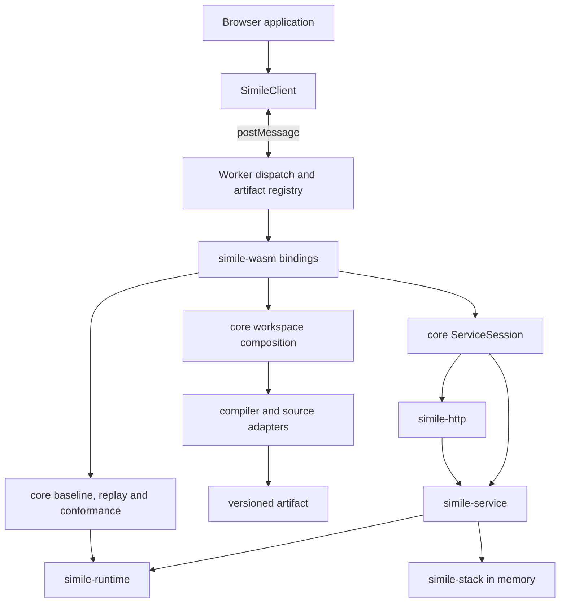
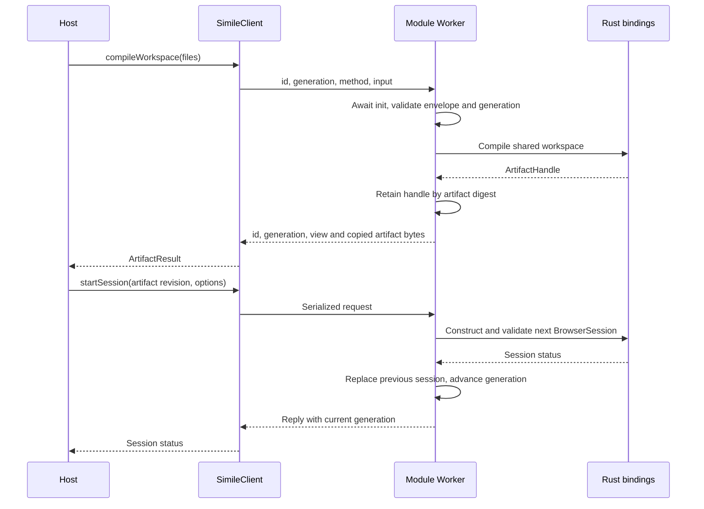
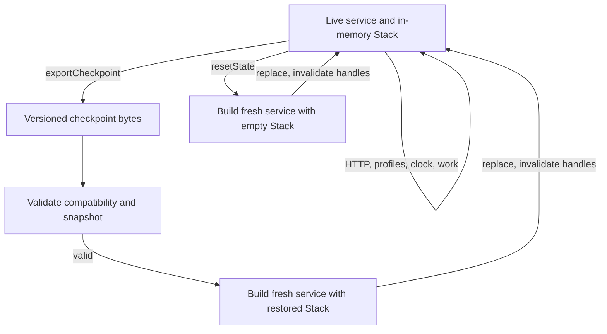

# WASM architecture

`simile-wasm` hosts Simile's shared Rust application in a browser. It exposes
compilation, artifact inspection, reproducible runs, and stateful HTTP sessions
through `wasm-bindgen` and a typed module Worker protocol. The host translates
values and manages object lifetimes; application behavior stays in the shared
crates used by the CLI and native server.

See the [README](README.md) for setup and API usage, and the
[playground architecture](../../playground/ARCHITECTURE.md) for the UI host.

## Boundaries and ownership

Arrows show calls or data flow. These are logical layers inside one WASM instance,
apart from the application and client on the main thread. Each Worker owns its own
instance, artifact registry, and optional active session.

| Location | Responsibility |
| --- | --- |
| [src/lib.rs](src/lib.rs) | Compile/load artifacts, expose descriptions and audit results, synthesize requests, run baselines, replay bundles, and run conformance. |
| [src/session.rs](src/session.rs) | Adapt JavaScript HTTP, profile, clock, work, and checkpoint inputs to `core::ServiceSession`. |
| [src/boundary.rs](src/boundary.rs) | Serialization, checked decimal conversions, byte buffers, and structured diagnostics. |
| [web/contract.ts](web/contract.ts) | Method inputs/outputs and runtime validation of message envelopes. |
| [web/client.ts](web/client.ts) | Serialize calls, correlate replies, and track Worker generation. |
| [web/worker.ts](web/worker.ts) | Initialize WASM, dispatch calls, retain artifact handles, replace sessions, and transfer response buffers. |
| [core workspace](../simile-core/src/workspace.rs) and [core session](../simile-core/src/session.rs) | Shared composition and session behavior; changes here also apply to other hosts. |

The native server and this host both use [simile-http](../simile-http/src/lib.rs).
Its head validation routes, authenticates, and checks parameters before body
handling. The native listener can reject a request before collecting its body;
the Worker receives already supplied bytes. Both use the same body limits,
response construction, repeated-header handling, HEAD behavior, and errors.
TCP listeners and outbound webhook delivery stay outside this crate.

## From source to an executable artifact

`compileWorkspace` accepts a virtual file map. Shared workspace composition
resolves a Simfile or a direct contract entry, optional HCL modules, setup, and
fixtures. OpenAPI or semantic TypeScript supplies the complete HTTP contract;
HCL adds behavior without redefining routes or request/response shapes.
TypeScript declarations are parsed, not executed as browser JavaScript.

The compiler produces the versioned `.similec` representation. `loadArtifact`
decodes that same representation, including compatible artifacts produced by
native Smithy compilation. Smithy **source** compilation is unavailable in the
portable build and returns `unsupported_source`. Unsupported or invalid artifact
bytes return `artifact_incompatible` before becoming a candidate.

An `ArtifactHandle` owns decoded data and encoded bytes. Its view supplies route
metadata, `acceptsBody`, description, audit, and composition information when
available. The artifact revision is its payload SHA-256 digest. Loading an artifact
does not recover the original source files or workspace composition metadata.

## Messages and artifact lifetime

The client waits for each reply before sending the next request. The Worker also
serializes dispatch and rejects a stale generation before executing a call.
Failures return `{ code, message, file? }` diagnostics. Domain errors leave the
queue usable. Host-level timeout and Worker recovery are the embedding
application's responsibility; the shared client does not implement a watchdog.

Compile/load only adds a candidate. `startSession` constructs and validates its
replacement before freeing the previous session. Failed compilation, decoding,
or session construction leaves the active session available. `runOperation`
uses a fresh runtime for its selected artifact, independent of the active session;
replay and conformance likewise use shared application operations.

The Worker retains candidates until termination; inserting the same digest frees
the previous handle for that digest. There is no eviction API. Inputs are cloned
so callers can reuse artifact and checkpoint buffers. Only response-owned buffers
are transferred; returning artifact bytes first copies them out of Rust.

Three counters serve different purposes:

| Value | Meaning |
| --- | --- |
| Artifact `revision` | Content digest selecting an immutable compiled artifact. |
| Envelope `generation` | Worker lifetime token, advanced after successful start/reset/restore to reject queued calls for the previous session state. |
| Session `generation` / `revision` | Core session replacement count and change counter, used to identify captured state. A new session starts its own counters. |

## The JavaScript boundary

| Data | Representation and rule |
| --- | --- |
| Seeds, logical time, 64-bit counters | Decimal strings, range-checked in Rust. Never convert through JavaScript `Number`. |
| Request documents, body JSON, profiles, reports | JSON text such as `requestDocJson` or `reportJson`. Keep this text when reusing/exporting payloads to preserve large nested integers. |
| HTTP bodies, artifacts, bundles, checkpoints | `Uint8Array`; encoding/decoding text is an explicit caller action. |
| Headers | `[name, Uint8Array]` pairs preserve repeated values and bytes. The shared HTTP map normalizes names and groups values by name. |
| Absent body | Omit `body`. JSON `null` is a present body containing the bytes for `null`; it is not an absent body. |
| Optional metadata and maps | Absent fields are omitted, explicit nulls remain null, and maps become plain objects. |

Request synthesis creates a body fixture only when the contract declares a body;
otherwise the request document is `{}`. Route parameter metadata is exposed, but
parameter values remain caller inputs. A selected fixture cannot change the
compiled contract's request-body support.

## Sessions, checkpoints, and deferred work

Browser sessions default to manual time at the Unix epoch. Realtime sessions use
`Date.now()` for their default initial time and `web-time` for elapsed time in the
Stack. Entropy is enabled through `getrandom`'s `wasm_js` feature at this host
boundary. Supply seeds, clock settings, and webhook signing timestamps explicitly
when comparing native and browser behavior.

Reset retains the compiled artifact and original clock configuration. Restore
checks checkpoint version, exact artifact digest and format, service identity,
Stack protocol, clock consistency, resource set, and snapshot validity before
replacement. It restores Stack resources, profiles, outbox, journal, and clock.
HTTP replay caches and fault RNG progress restart in the new service. A checkpoint
is therefore a state restore, not a suspended WASM process. Export only captures
bytes; storage durability belongs to the host.

`stepWork` leases causally ready items and returns opaque handles bound to the
session instance, generation, and queue receipt. Before prepare/execute/ack/retry,
the underlying receipt must still be current and unexpired. Its visibility window
is 30,000 ms. Stale handles fail without state changes, including after a second
lease of the same item. Async effects and acknowledgement commit together.
Webhook preparation returns signed bytes for an explicit timestamp; the host
simulates delivery by acknowledging or retrying. Inspection never leases work.
Reset, restore, and session replacement invalidate old handles. Checkpoints retain
queue visibility deadlines, but do not persist handles.

## Build and verification boundaries

Rust builds a `cdylib` for `wasm32-unknown-unknown` under Rust 1.85.0.
`wasm-bindgen` generates JavaScript glue and declarations; the Worker imports that
glue and initializes the module once. Generated `pkg/` and `dist/` are build outputs.
The crate also provides an `rlib` for Rust builds/tests.

Workspace dependencies disable native defaults at this boundary. The native CLI
continues enabling its native capabilities. The portable graph excludes Axum,
Tokio, redb, fs2, ureq, and Tree-sitter; UI, IndexedDB, and network delivery are host
concerns, not dependencies to add to the bindings.

| Proof | Entry point |
| --- | --- |
| Target build and forbidden dependencies | [check-portable.sh](../../scripts/check-portable.sh) |
| Real-browser Rust compilation/execution and parity fixtures | [browser.rs](tests/browser.rs), run by [test-browser.sh](../../scripts/test-browser.sh) |
| Typed API, byte/number boundaries, native Smithy artifacts, and session lifecycle in a real Worker | [worker-page.mjs](tests/worker-page.mjs), run by [test-worker.sh](../../scripts/test-worker.sh) |
| Native/in-memory equivalence and session regression coverage | [portable_parity.rs](../simile-core/tests/portable_parity.rs), [session_lifecycle.rs](../simile-core/tests/session_lifecycle.rs) |

Keep domain fixes in the owning shared crate, boundary conversions in Rust
bindings, and messaging/lifetime policy in the Worker. This lets native and browser
tests exercise the same behavior.
