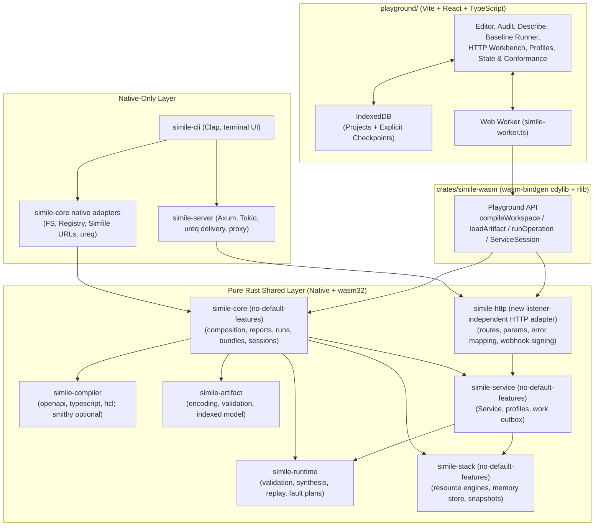

# Simile WebAssembly Target & Browser Playground — Technical Design and Implementation Plan

## 1. Goals & Scope

Enable Simile's portable libraries to compile to `wasm32-unknown-unknown` and power an interactive browser playground in `playground/` (Vite + TypeScript + React). Cover the authoring, validation, and operation-execution portions of [docs/define-a-service.md](../docs/define-a-service.md), then hand off to native Simile for registration and verification with external HTTP clients.

This document plans future implementation. Updating it does not authorize implementation work.

### In Scope

- **In-browser authoring and proof loop:**
  - Author or upload an OpenAPI (YAML/JSON) or multi-file semantic TypeScript (`.d.ts`) contract, a `Simfile`, HCL behavior modules (`behavior/*.hcl`), and request fixtures (`requests/*.json`).
  - Compile into a real `.similec` artifact in the browser, inspect its summary, render the public service description (`describe`), and run the fidelity audit (`audit` / `--strict`).
  - Exercise baseline operations (`simile run`): synthesize seeded requests, supply custom request JSON, test `outcome`/`scenario` overrides, inspect planned webhooks, capture/replay reproduction bundles, and run suites of those bundles using shared conformance semantics.
  - Run an in-process stateful HTTP workbench: use the same route matching, authentication, `principal_setup` profiles, parameter/body validation, idempotency/replay, scenarios, and effect execution as the native service. Inspect Stack state and the causal journal, step async work and webhooks, and visualize transport plans (`RespondAfter`, `DisconnectAfterCommit`).
  - Preserve project notes for public evidence, assumptions, and accepted audit findings; these notes do not affect compilation.
- **Drop-in `.similec` artifact mode:**
  - Users can drag-and-drop artifacts whose format is supported by the loaded engine, including artifacts compiled locally from **Smithy 2.0**, and inspect, describe, audit, run baseline operations, and submit requests through the workbench.
  - Preserve envelope, integrity, and payload validation. Report found/supported format versions and a recompile/engine-update remedy on incompatibility; do not hard-code a format version in the UI. Loading an artifact does not recover its original source files or live service state.
- **Seamless local handoff:**
  - Export compiled `.similec` bytes from either mode. Export a source workspace archive only when source files are available. In quick-authoring mode, preparing a runnable export must add a valid Simfile with the selected contract and module paths.
  - Generate commands using the actual service name: register, run required principal setup, then start. Verify that an exported workspace works unchanged with those commands and a real HTTP client. Artifact-only export does not imply source reconstruction or a new CLI artifact-start capability.

### Browser HTTP Boundary

The workbench submits request data directly to a Rust HTTP adapter in a Worker. It opens no TCP port and provides no service-worker interception of arbitrary `fetch()` calls. Delay/disconnect displays simulate transport outcomes; they do not prove actual socket behavior. Copyable `curl` examples target the configured native listener and are labeled for use after local handoff. Meeting the guide's external-client definition of done requires that native verification step.

### Out of Scope (For Now)

- **Smithy 2.0 compilation in the browser:** [crates/simile-smithy/Cargo.toml](../crates/simile-smithy/Cargo.toml) relies on C-based `tree-sitter` + `tree-sitter-smithy`. Smithy compilation will be feature-gated off on `wasm32` with a clear diagnostic pointing users to drop a CLI-compiled `.similec` artifact instead.
- **Native-only host features:** TCP listener binding, `simile proxy --to ...`, subprocess test supervision (`simile test -- <cmd>`), local `~/.simile` registry, and the 8 standalone `simile-*` stack binaries.
- **Browser networking extensions:** service-worker interception, a hosted runtime/native bridge, and real outbound webhook delivery. The initial webhook inbox simulates recipient outcomes. Remote Simfile/contract fetching is deferred; users import local project files.
- **Exact session continuation across reloads:** checkpoints restore durable Stack state into a fresh runtime. Persisting runtime replay caches and fault RNG progress is deferred; see the checkpoint contract below.

---

## 2. Target Architecture

Preserve the workspace ownership boundaries in [AGENTS.md](../AGENTS.md). Share application workflows in a portable `simile-core`, source-language coordination in `simile-compiler`, execution in `simile-runtime`/`simile-service`, and resource engines in `simile-stack`. Isolate filesystem, network, listener, and registry adapters behind native features. Only the WASM binding and reusable HTTP adapter require new crates.



> [!IMPORTANT]
> **Shared behavior, verified parity:** Keep application report types and workflow policy in `simile-core`; do not move listener, registry, or report metadata into artifact-format or execution libraries. Preserve native JSON schemas. Prove parity with fixtures using identical logical source names, artifacts, requests, seeds, initial state, clocks, and signing timestamps. Compare host metadata separately. Shared code alone does not guarantee byte-identical results.

---

## 3. Detailed Rust Implementation Plan

### Phase 1 — Core `wasm32-unknown-unknown` Portability

Make the existing lower crates compile and run cleanly on `wasm32-unknown-unknown` with **zero behavior change on native**.

1. **Workspace & Cargo Configuration**
   - [Cargo.toml](../Cargo.toml):
     - Set `default-features = false` in the **workspace dependency entries** for `simile-compiler`, `simile-core`, `simile-service`, and `simile-stack`. Rust 1.85 with edition 2024 rejects disabling inherited defaults only in a member when the workspace leaves them enabled. See [Cargo inheritance rules](https://doc.rust-lang.org/edition-guide/rust-2024/cargo-inherited-default-features.html).
     - Explicitly opt native consumers into the features they use: the CLI enables core `native` and `smithy`; the server enables service `persistence`; native core adapters enable service/Stack persistence; standalone Stack binaries require `process`. Preserve existing native behavior and direct crate defaults.
     - Audit every dependency edge, including the new HTTP crate and dev-dependencies. Shared core/HTTP/WASM dependencies must not re-enable native features or Smithy. Build the browser package separately from native workspace packages because Cargo unifies features within a build graph.
     - Add workspace dependencies:
       - A pinned, Rust-1.85-compatible `web-time` version for browser realtime clocks; retain native clocks on native targets.
       - Enable the locked `getrandom` 0.3.4 `wasm_js` feature at the browser host/test boundary under `cfg(all(target_arch = "wasm32", target_os = "unknown"))`. Audit any other reachable `getrandom` versions and enable their corresponding browser support only if required.
       - `wasm-bindgen`, `js-sys`, `serde-wasm-bindgen` (used only by `crates/simile-wasm`).
     - Keep `rust-version = "1.85"` respected across all newly added dependencies (verify with `cargo check` under the pinned `1.85.0` toolchain).
   - The locked `getrandom` 0.3.4 needs its browser feature, not a global `getrandom_backend` rustflag. Keep browser-specific entropy configuration out of unrelated native/WASI consumers. See [getrandom 0.3.4 support](https://docs.rs/getrandom/0.3.4/getrandom/).
   - [deny.toml](../deny.toml):
     - Verify all added crates pass `cargo deny check` (licenses are MIT/Apache-2.0, already allowed; watch `multiple-versions` warnings).
   - Inspect `cargo tree -p simile-wasm --target wasm32-unknown-unknown -e features` and require no reachable Axum, Tokio, redb, fs2, ureq, or Tree-sitter dependencies. Add a CI graph check so indirect feature changes cannot silently restore them.

2. **`crates/simile-stack` — Feature-gate native server, persistence & binaries**
   - [crates/simile-stack/Cargo.toml](../crates/simile-stack/Cargo.toml):
     - Define features:
       ```toml
       [features]
       default = ["native"]
       native = ["persistence", "process"]
       persistence = ["dep:fs2", "dep:redb"]
       process = ["persistence", "dep:axum", "dep:clap", "dep:tokio", "dep:tracing", "dep:tracing-subscriber"]
       ```
     - Mark `axum`, `clap`, `fs2`, `redb`, `tokio`, `tracing`, `tracing-subscriber` as `optional = true`.
     - Add `required-features = ["process"]` to all 8 `[[bin]]` targets (`simile-db`, `simile-cache`, `simile-queue`, `simile-mail`, `simile-object-store`, `simile-event-bus`, `simile-scheduler`, `simile-http`).
     - Add `web-time` under the browser target condition above.
   - [crates/simile-stack/src/lib.rs](../crates/simile-stack/src/lib.rs):
     - Gate `#[cfg(feature = "process")] pub mod process;`.
     - Gate `#[cfg(feature = "persistence")] pub use store::RedbStateStore;`.
   - [crates/simile-stack/src/store.rs](../crates/simile-stack/src/store.rs):
     - Gate `mod redb;`, `pub use redb::RedbStateStore;`, `default_component_state_path`, `component_state_path`, `simile_home`, and `lock_path` under `#[cfg(feature = "persistence")]`.
     - Keep `StateStore`, `MemoryStateStore`, `StateIdentity`, `StateStoreError`, and `StateStoreResult` unconditionally available.
   - [crates/simile-stack/src/time.rs](../crates/simile-stack/src/time.rs):
     - Make manual clock construction, advancement, and restoration independent of `Instant::now()`. Only realtime mode owns a host-clock anchor; use `web_time::Instant` for that anchor on the browser target and `std::time::Instant` natively.

3. **`crates/simile-service` — Feature-gate `RedbStateStore` & fix `now()`**
   - [crates/simile-service/Cargo.toml](../crates/simile-service/Cargo.toml):
     - Add `default = ["persistence"]` and `persistence = ["simile-stack/persistence"]`. Inherit the workspace's disabled defaults for Stack; enabling persistence must not enable its process host.
     - Add `web-time` under the browser target condition above.
   - [crates/simile-service/src/lib.rs](../crates/simile-service/src/lib.rs):
     - Gate `Service::durable` and its `RedbStateStore`/`Path` imports under `#[cfg(feature = "persistence")]`.
     - Preserve the current native realtime default. Add explicit initial clock/mode configuration and `advance_clock` support for embedded sessions. Manual mode receives its start time from the caller; realtime browser mode uses `web_time::SystemTime` for its initial wall time.
     - Expose the validated primitives needed by shared core session lifecycle helpers. Restore behavior must follow the checkpoint contract in Phase 3, rather than replacing only the Stack inside an existing runtime.

4. **`crates/simile-compiler` — Optional `smithy` feature**
   - [crates/simile-compiler/Cargo.toml](../crates/simile-compiler/Cargo.toml):
     - Add `default = ["smithy"]` and `smithy = ["dep:simile-smithy"]`, making `simile-smithy` optional.
   - [crates/simile-compiler/src/lib.rs](../crates/simile-compiler/src/lib.rs):
     - Keep `ContractSource::Smithy(Source<'a>)` in the enum so downstream callers don't need `#[cfg]` on match arms; when `not(feature = "smithy")`, return a dedicated error variant `Error::UnsupportedContractSource { format: &'static str, name: String }` with a helpful message explaining that Smithy compilation is unavailable in this build and suggesting compiling to `.similec` with the CLI.
     - Gate every reference to Smithy dependency types, including error variants and conversions. Test both configurations independently; native all-features tests alone cannot exercise the disabled branch.

5. **`crates/simile-core` — Portable application operations with native adapters**
   - Keep application types and in-memory workflows available without default features. Add `native` for filesystem, environment, registry, URL loading, reporting transport, and persistence adapters, plus `smithy = ["simile-compiler/smithy"]`. Set direct core defaults to `default = ["native", "smithy"]` to preserve existing native capability; workspace consumers opt in explicitly.
   - Make `ureq` optional under `native`. Gate native modules, re-exports, error variants, and imports consistently; shared errors must not reference disabled dependencies.
   - Split file loading/writing from calculation within existing `ops` modules. Native CLI-facing entrypoints retain their signatures and output schemas and delegate to the shared operations described in Phase 2.

**Phase gate:** prove artifact decoding, seeded runtime execution, OpenAPI/HCL compilation, and Oxc TypeScript parsing in an actual browser/Worker before broad UI work. Use a minimal binding smoke test, then expand the API in Phase 3. Verify target portability and the pinned toolchain; do not infer it from native compilation.

---

### Phase 2 — Shared Application Workflows & Listener-Independent HTTP Adapter

Preserve every CLI output schema (exact `#[serde(rename_all = "camelCase")]` field names) while making the operations reusable from WASM.

1. **Shared service composition**
   - Expose an in-memory project resolver and `compile_workspace` operation in `simile-core`. Filesystem loading and URL fetching populate the same source inputs through native adapters. The WASM wrapper delegates to this operation rather than maintaining its own composition algorithm.
   - Preserve the complete behavior of [prepare_loaded_service](../crates/simile-core/src/ops/start.rs): validate service names, reporting endpoints, and listener metadata; resolve the selected contract; include `document.inline_module` and external modules; compile principal setup declarations; and retain the service description.
   - Keep source-language coordination in `simile-compiler`. Extract a compiler entrypoint for assembled service documents so both hosts use the same inline-module, `compile_principal_setups`, and description assembly logic after source resolution. Syntax remains in the source adapters; source names, virtual paths, and host metadata remain application concerns.
   - Preserve TypeScript entry-file import traversal and directory behavior: recursive declaration collection, `.test.d.ts` exclusion for directory entrypoints, stable ordering, and existing import candidate rules. Normalize virtual paths consistently and report missing/escaping paths as project diagnostics.
   - Retain native default heuristic policy and source validation. Test equivalent named source inputs across native and virtual loaders.

2. **Pure Fidelity Audit (`audit_artifact`)**
   - Keep `AuditSeverity`, `AuditFinding`, `AuditReport`, and audit policy in [simile-core/ops/audit.rs](../crates/simile-core/src/ops/audit.rs). Expose `audit_artifact(&Artifact) -> AuditReport` without file I/O.
   - Gate the existing path-based wrapper under `native`; it reads, decodes, and delegates. Share strict acceptance policy with the playground so warning/error treatment cannot diverge.

3. **Pure Service Description (`describe_artifact`)**
   - Keep catalogue construction and application reports in [simile-core/ops/describe.rs](../crates/simile-core/src/ops/describe.rs). Extract a portable catalogue plus explicit host metadata; native rendering continues to produce the existing `DescribeServiceReport` JSON schema.
   - Standalone artifacts have no known listener, source workspace, or registry revision. Return absent host metadata to the browser rather than fabricating a listener or changing the native report contract. Artifact inspection remains in `simile-artifact`.

4. **Pure Baseline Execution, Reproduction & Conformance**
   - Expose `run_artifact` in [simile-core/ops/run.rs](../crates/simile-core/src/ops/run.rs): request-document parsing, operation selection, seeded synthesis, runtime invocation, and `RunReport` construction. Native input loaders delegate. Preserve one-shot semantics separately from stateful service execution.
   - Extract in-memory bundle creation and replay within [simile-core/ops/reproduce.rs](../crates/simile-core/src/ops/reproduce.rs), retaining native manifests, digest checks, format validation, and expected-response comparison. Serialize bundle JSON in Rust.
   - Expose conformance over named in-memory bundle sets in [simile-core/ops/conformance.rs](../crates/simile-core/src/ops/conformance.rs). Native directory discovery and browser archive import feed the same sorted cases and aggregate pass/fail report. Preserve supported response/incident bundle distinctions and reject unsupported inputs explicitly.

5. **Pure State & Journal Inspection and Session Lifecycle**
   - Keep `StateReport` and application filtering in [simile-core/ops/state.rs](../crates/simile-core/src/ops/state.rs). Add inspection over a supplied snapshot/query/service identity. Stack continues to own resource and journal primitives.
   - The native wrapper opens `RedbStateStore` and delegates. Browser sessions supply their in-memory snapshots.
   - Keep session construction, reset, checkpoint identity/compatibility validation, and fresh-runtime restoration in shared core operations using `simile-service`. WASM owns only host handles and serialization.

6. **New Crate: `crates/simile-http` (Listener-Independent HTTP Adapter)**
   - Justified by a real reuse boundary ([AGENTS.md](../AGENTS.md)): shared by `simile-server` (Axum/Tokio) and `simile-wasm` (browser/Workers).
   - Dependencies: `form_urlencoded`, `percent-encoding`, `rand`, `serde`, `serde_json`, `sha2`, `simile-artifact`, `simile-runtime`, `simile-service`, `simile-spec`, `thiserror` (zero `axum`, `tokio`, or `ureq`). Inherit service with defaults disabled. Reuse a portable HTTP types crate if needed to preserve method/header validation.
   - Moves out of [crates/simile-server/src/lib.rs](../crates/simile-server/src/lib.rs) and [crates/simile-server/src/delivery.rs](../crates/simile-server/src/delivery.rs):
     - `RouteTable`, `PathTemplate`, `PathSegment`, `Match`, and route listing (`routes(&self)` so the playground UI can list clickable routes & path parameters).
     - Plain transport structs:
       - `HttpRequest { method: String, path: String, query: Option<String>, headers: Vec<(String, String)>, body: Vec<u8> }`
       - `HttpResponse { status: u16, headers: Vec<(String, String)>, body: Vec<u8> }`
       - `HttpExchange { response: HttpResponse, matched_operation: Option<String>, selected_outcome: Option<String>, transport: TransportPlan, fault: Option<FaultActivation>, authenticated_profile: Option<String>, authenticated_principal: Option<String>, incident: Option<RuntimeIncident> }`
     - `HttpAdapter::handle(&self, request: HttpRequest, controls: RequestControls) -> HttpExchange`:
       - Exact same route matching, `incoming_parameters` (query/header/cookie parsing), `Service::authenticate`, `validate_parameters`, `Content-Type` / `Idempotency-Key` extraction, `GET` resource replay identity, `Service::execute_for_profile_with_options`, `operation_error` / `service_error_cause` / `runtime_error` / `method_not_allowed` mapping, and `HEAD` body stripping.
       - Preserve response-header validation and wire body encoding. Test body-limit rejection in both hosts; native hosts may reject before buffering, while the workbench enforces the same configured limit before execution.
       - Accept explicit response seeds for deterministic host parity tests and workbench requests. Keep scenario/fault/seed controls out of emulated request headers. Native default entropy behavior remains unchanged. Error-response synthesis must use the supplied deterministic controls as well.
     - Pure webhook dispatch preparation (`order_leases`, `prepare_webhook_request(service, lease, unix_timestamp_secs) -> PreparedWebhookRequest { method, url, headers, body }`, `webhook_signature`, `retry_delay`) so the playground renders exact signed webhook requests (`t=...,v1=...`) and follows the exact causal ordering & retry math as `simile-server`.
   - Refactor `crates/simile-server` to delegate request handling to `simile-http::HttpAdapter` and keep Axum/Tokio responsible only for TCP listening, `DEFAULT_BODY_LIMIT`, `tokio::time::sleep` for `RespondAfter`, streaming connection-reset for `DisconnectAfterCommit`, access logging, `ureq` webhook sending, proxy, and test command supervision.
   - Share deferred-work eligibility, causal readiness, retry, acknowledgment, and dead-letter policy through service primitives. Browser stepping and the native dispatcher must obey the same prerequisites; inspection alone must not lease or acknowledge work. Prepared webhook bytes and signing timestamps are explicit inputs to parity tests.

---

### Phase 3 — `crates/simile-wasm` Crate & JavaScript/TypeScript Contract

Create `crates/simile-wasm` as a workspace member:

- `crate-type = ["cdylib", "rlib"]`
- Dependencies: portable `simile-core`, `simile-http`, shared model/execution types needed by bindings, `serde`, `serde_json`, `serde-wasm-bindgen`, `wasm-bindgen`, `js-sys`, and browser entropy support. Inherit disabled defaults for every affected workspace dependency; do not invoke source adapters directly from the binding crate.
- **Lints:** Start with workspace lints intact. Verify the pinned `wasm-bindgen` macro against `unsafe_code = "forbid"` before proposing an exception. If generated shims require one, document the narrow binding-crate exception and retain all other workspace lints and zero handwritten unsafe code. Do not relax core-crate lints preemptively.
- **Native CI compatibility:** Test shared composition and session logic in native Rust. Gate browser-only tests appropriately and run them in browsers separately; native `cargo test` does not execute WASM tests or validate JavaScript interoperability.

#### Virtual Workspace Composition (In-Memory `Simfile` + Multi-File TypeScript)

Accept `{ files: Record<string, string>, configPath?: string, contractEntry?: string, modules?: string[], heuristicPolicy?: Policy }` and delegate to shared core composition:

1. An explicit `configPath` or discovered root `Simfile` selects service composition. Its contract and module declarations are authoritative; reject conflicting direct-entry/module overrides. Include inline HCL, principal setups, descriptions, and metadata validation through the Phase 2 pipeline.
2. Without a Simfile, require an unambiguous OpenAPI/TypeScript contract entry (file or TypeScript directory) and optional selected HCL modules. Ambiguous uploads produce a selection diagnostic. Preserve imported directory paths, import candidate rules, exclusions, and stable source ordering.
3. Resolve paths inside the virtual project. Reject unresolved remote references with a structured diagnostic in this release. Report disabled Smithy compilation through the compiler's capability error while allowing supported Smithy-produced artifacts.
4. Encode and decode with `simile-artifact` before reporting compile success: schema compilation and artifact validation are part of the proof boundary. Return the exact `.similec` bytes and an immutable revision identified by its digest.

#### Lossless Browser Data Contract

- Use browser DTOs at the WASM boundary; preserve existing native report schemas. Engine metadata, selectors, diagnostics, and headers use typed objects. All public 64-bit integer fields, including seeds, logical milliseconds, and journal sequences, use **decimal strings**. Validate integer ranges in Rust; do not round-trip them through JavaScript `number`. Bounded counts/limits may use checked safe integers.
- Keep arbitrary request/response JSON as UTF-8 JSON text or raw body bytes across JavaScript. `requestDocJson`, `bodyJson`, and `reportJson` are produced/parsed in Rust so payload integers and explicit `null` remain intact. Do not `JSON.parse`/`JSON.stringify` those payloads to construct requests or downloadable evidence. Explicitly distinguish an omitted body from a present JSON `null` body.
- Serialize bundles and checkpoints in Rust. The frontend treats their JSON text/binary files as opaque bytes for export and replay. DTO views may expose selected metadata without changing the canonical bundle/report representation.
- Configure object-map and null/optional-field handling explicitly in `serde-wasm-bindgen`. Use explicit byte serialization or `Uint8Array` construction for binary fields; plain `Vec<u8>` serialization must not be assumed to produce a typed array. Preserve repeated HTTP headers as ordered name/value pairs.
- Publish matching TypeScript types and runtime validation for the Worker RPC contract. Diagnostics include a stable code, message, and optional file/span or semantic subject; show locations only where source adapters retain them.
- Cover `0`, `2^53 - 1`, `2^53`, and `u64::MAX` seeds; signed integer boundaries; nested payload integers; body absence versus `null`; repeated headers; map shape; and binary transfer in browser tests. [serde-wasm-bindgen serialization behavior](https://docs.rs/serde-wasm-bindgen/0.6.5/serde_wasm_bindgen/struct.Serializer.html)

#### Session, Reset & Checkpoint Contract

- A session owns one immutable artifact revision, service/runtime instance, clock configuration, and generation of work handles. New playground sessions default to manual time with an explicit start value (Unix epoch by default); realtime is an opt-in host clock. Native defaults remain unchanged.
- Reset constructs a fresh service/runtime for the same artifact and initial clock configuration. It clears resource data, dynamic profiles, outbox/journal, HTTP replay records, and fault-controller progress. Artifact-declared fixtures remain available. Invalidate all browser work handles and show the reset scope in the UI.
- A saved checkpoint contains the complete Stack snapshot and a versioned application envelope: service identity, artifact digest/format, checkpoint and Stack protocol versions, clock mode/time, and save revision. Store the corresponding artifact bytes with the checkpoint. Reject unsupported versions, identity/resource mismatches, and incompatible data before changing the active session. This browser checkpoint format is separate from `.similec`.
- **Restore means restart:** validate the checkpoint, create a fresh runtime, and restore the saved Stack state. HTTP replay caches and fault RNG progress are not restored; this matches their current process-local lifetime. Exact session continuation and stateful request-history replay are deferred. Tests must verify the documented restart semantics rather than promise identical next responses from a Stack snapshot alone.
- Restoring/resetting/replacing a session invalidates outstanding lease handles. Restored queue leases retain their persisted visibility rules and become available under the normal timeout policy; old browser handles cannot acknowledge them.
- Recompilation creates a candidate revision and does not modify the running session. Starting a new revision requires an explicit action. Initial compatibility policy requires an exact artifact digest for checkpoint restore; changing the artifact starts fresh state unless a future migration policy explicitly permits reuse.
- **Persistence is explicit checkpoint saving.** Memory commits acknowledge execution only. Save at a completed request/work boundary, write the checkpoint and artifact in one IndexedDB transaction, and show success only after that transaction completes. Track the saved session revision and subsequent unsaved mutations; saving must not freeze a newer session or mislabel it as saved. A failed/quota-exceeded save leaves the live session usable and marked unsaved.
- Workspace file autosave is separate from execution state. On reload, offer the last completed checkpoint and explain restart semantics. Do not implement IndexedDB as a synchronous `StateStore` that reports success before asynchronous persistence completes.

#### Exported WASM API Surface

The following API is proposed; exact naming may change while the data and lifecycle contracts above remain acceptance requirements. `Decimal` means a range-checked decimal string. `BundleFiles` contains exact named file bytes, and `ReportView` contains canonical `reportJson` plus lossless metadata/body views for display.

| Export | Input | Output | Purpose |
| --- | --- | --- | --- |
| `compileWorkspace(input)` | Virtual project input above | Artifact bytes, revision digest, summary/catalogue, audit, routes, optional host metadata | Full composition and proof |
| `loadArtifact(bytes)` | `Uint8Array` | Compatible artifact handle/revision, catalogue, audit, routes, principal setups | Validate before replacing the active artifact; preserve current state on failure |
| `synthesizeRequest(artifact, selector, seed?)` | Artifact handle, operation selector, optional `Decimal` seed | `Decimal` seed, `requestDocJson`, content type, body bytes | Seeded body fixture generation; parameter fields come from route metadata |
| `runOperation(artifact, opts)` | Selector, `requestDocJson?`, `Decimal` seed, outcome/scenario | `ReportView`, optional `BundleFiles` | Fresh one-shot runtime and reproduction capture |
| `replayBundle(files)` | `BundleFiles` | Replay report/view | Same semantics as `simile replay` |
| `runConformance(cases)` | Named `BundleFiles` sets | Ordered case results, totals, canonical report JSON | Same acceptance as `simile conformance` |
| `ServiceSession` | Artifact handle, scenario/fault profile, clock mode/start time | Stateful session handle | Uses shared core lifecycle; independent of baseline runs |
| `session.handleRequest(req, controls)` | Method/path/query, header pairs, body bytes, optional `Decimal` response seed | HTTP exchange DTO with body bytes, response headers, transport/fault, profile, seed | Execute through the shared HTTP adapter |
| `session.setupProfile(req)` / `listProfiles()` | Principal/profile, `valuesJson`, selection | Profile metadata and explicit sensitive issued-value view | Shared principal setup and profile behavior |
| `session.inspectState(query)` | Resource/causation/correlation, `Decimal` after-sequence, safe limit, include-values | State report/view | Resource and journal inspection |
| `session.advanceClock(ms)` | Unsigned `Decimal` milliseconds | Advance report/view | Manual time only |
| `session.resetState()` | None | New session generation/revision | Fresh runtime and state; invalidate old work handles |
| `session.exportCheckpoint()` | None | Envelope/snapshot bytes and captured revision | Capture without claiming disk persistence |
| `session.restoreCheckpoint(bytes)` | Checkpoint bytes | New session generation/revision | Validate, then restore into a fresh runtime |
| `session.stepWork()` / work-handle methods | Limits, opaque generation-scoped handles, `Decimal` retry delays/timestamps | Async work, prepared webhook bytes, readiness/retry/dead-letter results | Causal stepping and simulated recipient outcomes |

---

### Phase 4 — Browser Playground (`playground/` — Vite + TypeScript + React)

Create `playground/` at the repo root (alongside `crates/` and `receiver/`), managed with `pnpm`.

#### Core Architecture

- **Stack:** Vite + React + TypeScript + CodeMirror 6 (`@codemirror/lang-yaml`, `@codemirror/lang-json`, `@codemirror/lang-javascript`, lightweight HCL syntax highlighting).
- **Web Worker (`src/worker/simile.worker.ts`):**
  - Loads the `simile-wasm` ESM bundle once (`init()`).
  - Holds immutable artifact handles and the live `ServiceSession` off the main thread. Track editor compilation revisions separately from the running service revision; stale compile responses cannot replace newer diagnostics or the active service.
  - Exposes a typed Promise-based RPC client (`src/worker/client.ts`) to React components.
  - Serialize session mutations and assign request/revision IDs. Transfer binary buffers without detaching the Worker's only retained artifact copy. Coalesce pending recompiles; provide cancellation/restart recovery for a long-running compilation and preserve unsaved source edits on Worker failure.
- **Persistence (`src/storage/idb.ts`):**
  - Autosaves project files/notes independently of runtime state. Stores exact artifacts and reproduction bundles, plus explicit versioned checkpoints according to Phase 3.
  - Show saving/saved/unsaved/error state using captured session revisions. Restore only completed IndexedDB transactions and validate the referenced artifact/checkpoint before creating a session.

#### UI Layout & Authoring Workflow (Mapped to `docs/define-a-service.md`)

1. **Top Bar & Mode Switcher**
   - **Starter Templates:**
     - *Orders API (OpenAPI + Simfile + HCL)* — follows [docs/define-a-service.md](../docs/define-a-service.md) using consistent paths (`orders.yaml`, `Simfile`, `modules/orders.hcl`, `requests/create-order.json`). The guide's introductory tree and later module example differ; the starter's Simfile must resolve the files actually exported.
     - *Semantic TypeScript Service* — multi-file `.d.ts` contract + HCL behavior example.
     - *Blank OpenAPI* / *Upload Files* / *Drop `.similec` Artifact*.
   - **Drag-and-Drop Zone:** Validate `.similec` before switching into **Artifact Mode**, which exposes Inspect, Describe, Audit, Baseline Runner, Conformance, and the Stateful HTTP Workbench. Explain that original sources are unavailable; do not display reconstructed source as authoritative. Invalid/unsupported artifacts leave the current project/session intact. Source uploads preserve virtual directory paths; ambiguous files require entry selection.
   - **Status Pill:** Live compile badge (`Compiled • N ops • SHA256` or inline error count) + `--strict` audit pass/fail badge.
   - **Export Menu:** Download the selected revision's `.similec`, a source workspace archive when available, bundles/suites, or a saved checkpoint. Runnable workspace export validates composition and adds a Simfile in quick mode. Include project notes and generated CLI commands for compilation, audit, registration, required setup, and start; only promise local parity for workflows verified by the shared pipeline.

2. **Left Sidebar — Virtual Project Tree (in Workspace Mode) / Operations Tree (in Artifact Mode)**
   - Create/rename/delete/upload files (`Simfile`, contract files, `behavior/*.hcl`, `requests/*.json`).
   - Quick-jump list of compiled operations (`METHOD /path` + `operationId` + badges for HCL override, secured, effects, webhooks).

3. **Main Workspace — 6 Focused Views**
   - **1. Author (Editor + Live Diagnostics):**
     - CodeMirror editor with debounced recompilation (~300ms), coalesced Worker requests, and structured diagnostics. Highlight exact locations where available; otherwise link the file or semantic subject. Compilation does not restart the active service.
     - Split or bottom drawer showing `ArtifactSummary` counters (operations, schema nodes, outcomes, effects, webhooks, backends, principals).
     - Project notes for evidence, assumptions, and accepted fidelity findings.
   - **2. Describe & Inspect (`simile describe` / `simile inspect`):**
     - Public service catalogue mirroring `simile describe --verbose`: operations + outcomes, principals + grants, `principal_setup` specs, backends, async operations, protocol errors, scenarios, faults/fault profiles, and webhooks.
   - **3. Fidelity Audit (`simile audit`):**
     - Summary cards (errors, warnings, info, provider-authored vs. convention-inferred).
     - Filterable findings table (`severity`, `code`, `subject`, `message`, `remediation`) with `--strict` acceptance toggle.
   - **4. Baseline Runner (`simile run`):**
     - Select operation by `operationId` or `METHOD /path`.
     - Load from `requests/*.json`, edit inline JSON (`headers`, `body`), or click **Synthesize Valid Request** (with editable/pinned `seed`).
     - Select optional `outcome` or `scenario` override.
     - View validated request, synthesized response (status, content-type, JSON body, provenance badge), planned webhooks, and **Capture Reproduction Bundle** (save/replay/download).
     - Keep seed controls as decimal text and render payload JSON from Rust-provided text without numeric conversion.
   - **5. Stateful HTTP Workbench:**
     - **Service Controls Bar:** Running artifact revision, explicit Start/Restart action, scenario/fault profile, logical clock mode (`Manual` by default or `Realtime`), time advancement, Reset State, and Save/Export/Restore Checkpoint. Changing controls must declare whether it requires restart; it must not silently discard state.
     - **Profiles & Setup Panel:** Dynamic form built from `principal_setup` declarations; creates profiles, lists active profiles, and offers a one-click **"Use Profile Credentials"** toggle that auto-attaches the profile's auth headers/query/cookies to outgoing requests.
     - **HTTP Request Workbench:** Route picker with path/query fields from contract metadata, content-type/body synthesis, editable repeated headers, explicit response seed, and **Send Request**. Do not describe placeholder parameters as synthesized valid inputs. Preserve raw JSON/wire bytes.
       - Show transport latency for `RespondAfter` and a simulated disconnect for `DisconnectAfterCommit`, including the committed-state result. Do not imply that a socket was opened or reset. Native handoff `curl` snippets identify the configured listener and setup prerequisites.
     - **Live Stack & Journal Inspector (`simile state`):** Tabbed view of every declared backend (`db`, `cache`, `queue`, `mail`, `object_store`, `event_bus`, `scheduler`, `http`) plus the causal event journal with filtering by resource/correlation ID.
     - **Async Work & Webhooks Outbox:** Non-mutating inspection of pending/leased work and dead letters, causal readiness, retries, and prepared webhook headers/body bytes. Provide **Execute Async**, **Simulate Recipient Success**, **Simulate Failure**, and **Redeliver DLQ** using shared dispatch rules. Real network delivery is deferred; a simulated acknowledgment is not recorded as proof of external delivery.
   - **6. Reproduction & Conformance:**
     - Import/export individual native-compatible bundles and named suites. Run all cases, show ordered per-case results and aggregate pass/fail counts, and link failures to their recorded artifact/request/seed.
     - Match current native replay/conformance semantics. These response/incident bundles are distinct from service checkpoints and do not claim to capture an arbitrary stateful session.

---

### Phase 5 — Build Tooling, Testing & CI Integration

1. **Local Build Scripts**
   - Pin compatible Rust/WASM tools, Node, pnpm, and frontend dependencies. Match `wasm-bindgen-cli` to the Rust `wasm-bindgen` version; install tooling separately if it requires a newer host compiler while continuing to compile the project with Rust 1.85.0.
   - Add a `playground/package.json` script pipeline (using locked Cargo builds plus the matching `wasm-bindgen --target web`, or pinned `wasm-pack`):
     - `pnpm run build:wasm` (compiles `crates/simile-wasm` into `playground/src/wasm/`).
     - `pnpm run dev` / `pnpm run build` / `pnpm run typecheck` / `pnpm run test` / `pnpm run test:e2e`.
   - Use a browser-specific release profile for size experiments without changing native release behavior. Measure download size, Worker startup, representative compile/execute times, and peak memory before selecting `opt-level` or `wasm-opt` settings; do not treat unmeasured size estimates as requirements.

2. **Verification & CI ([.github/workflows/ci.yml](../.github/workflows/ci.yml))**
   - **All existing native checks must remain 100% green:**
     - `cargo fmt --all --check`
     - `cargo clippy --workspace --all-targets --all-features -- -D warnings`
     - `cargo test --workspace --all-targets --all-features --locked`
     - `cargo doc --workspace --all-features --no-deps --locked`
     - `cargo deny check`
   - **New `wasm` CI job:**
     - Install `rustup target add --toolchain 1.85.0 wasm32-unknown-unknown`, pinned tooling, and browsers/drivers.
     - Run `cargo +1.85.0 check --target wasm32-unknown-unknown -p simile-wasm --locked` and `cargo +1.85.0 clippy --target wasm32-unknown-unknown -p simile-wasm --locked -- -D warnings`.
     - Check portable packages individually on native with defaults disabled; use `simile-wasm` as the entropy-enabled host for browser-target checks. Check the WASM feature graph separately. Native all-features testing must not mask accidental native dependencies or skip the disabled-Smithy branch.
     - Execute browser tests explicitly: `wasm-pack test crates/simile-wasm --headless --chrome --firefox --locked` using the pinned project compiler. Configure suites for browser execution with `wasm_bindgen_test_configure!(run_in_browser)`; add Worker execution coverage through the actual app RPC path. Verify the command against the pinned tool version. [Browser test runner](https://wasm-bindgen.github.io/wasm-bindgen/wasm-bindgen-test/browsers.html)
     - Install frontend dependencies with `pnpm --dir playground install --frozen-lockfile`; run `typecheck`, production `build`, frontend `test`, and `test:e2e` as separate required steps. The E2E script runs headless Playwright against the built app in Chromium, Firefox, and WebKit with their browser dependencies installed.
   - **Behavior & Parity Acceptance:**
     - Shared composition: identical named OpenAPI/HCL and TypeScript projects produce identical artifact bytes under the same compiler/policy. Include inline HCL, principal setups, service descriptions, invalid metadata, nested Simfile paths, import graphs, directory entrypoints, and `.test.d.ts` exclusion.
     - Artifact import: execute a CLI-compiled Smithy fixture without the Smithy frontend; reject incompatible formats, damaged envelopes, and invalid payloads while retaining the current session. Report supported format from the engine.
     - HTTP adapter: compare routes, percent-decoding, repeated query/header/cookie handling, auth/validation errors, body limits, HEAD/405 responses, response headers/body bytes, and protocol-error synthesis across native and WASM under controlled inputs.
     - Determinism: control response/request seeds, initial Stack state, manual time, artifact fault-profile seeds, and webhook signing timestamps. Compare domain reports and signed bytes exactly; assert host metadata separately. Native defaults may remain nondeterministic. Shared code is not a substitute for these comparisons.
     - Lifecycle: create with idempotency key, reset, and repeat must create fresh state; GET replay and fault progress must not survive reset. Checkpoint restore preserves Stack resources/profiles/outbox but starts new runtime replay/fault state. Reject wrong-artifact/version/resource snapshots, invalidate old work handles, and exercise restored lease visibility.
     - Bindings: exercise autogenerated and boundary seeds, payload integer fidelity, explicit null versus absence, map shape, binary transfer, and malformed input through WASM and Worker RPC.
     - Persistence: save, reload, and restore a completed checkpoint; simulate storage failure and verify unsaved status/live-session continuity. A delayed save acknowledgment must not mark newer mutations saved.
     - Browser E2E: author an Orders service, compile/audit, set up a profile, run create/read, advance time and step work, save/restore, then export/replay a bundle and execute a suite. Cover artifact drop, stale compile results, and explicit revision restart.
     - Local handoff: extract an exported workspace and run native register/setup/start plus a real HTTP request. Replay browser-exported bundles/suites in the CLI and import CLI-exported cases in the browser. Assert existing native CLI output/exit behavior remains unchanged.

**Release gate:** actual browser execution, the portable dependency graph, native regression checks, round-trip exports, and documented checkpoint semantics must pass. Passing only build/type checks is insufficient.

---

## 4. Risks, Edge Cases & Open Decisions

| Area | Risk / Consideration | Planned Mitigation |
| --- | --- | --- |
| **WASM binary size and responsiveness** | Parser/regex dependencies and schema graphs may make startup or compilation expensive; no size budget has been measured yet. | Measure during Phase 1, load in a Worker, coalesce compiles, and test cancellation/recovery. Consider a separate runtime-only bundle after measurements establish a benefit. |
| **MSRV 1.85 compatibility** | Recent releases of `wasm-bindgen`, `web-time`, or `getrandom` could bump MSRV above `1.85`. | Pin compatible versions in `Cargo.toml` and verify against the repo's `1.85.0` toolchain before locking. |
| **Feature inheritance/unification** | Rust 1.85 inheritance rules and transitive default features can prevent the portable build. | Disable relevant defaults at workspace level, opt native consumers in explicitly, and assert the browser dependency graph in CI. |
| **`unsafe_code = "forbid"` lint** | Generated bindings may interact with the workspace lint depending on the pinned macro version. | Test first; retain the lint unless a demonstrated binding-only exception is necessary. Core crates remain unchanged. |
| **Credential safety invariant** | [AGENTS.md](../AGENTS.md) forbids emitting secrets in logs/tracing. | Never log issued profile credentials or webhook secrets to browser console/tracing; display them only in masked/explicit-reveal UI controls inside the Profiles panel. |
| **Remote sources** | Native loading accepts remote configurations/contract URLs; module paths use configuration-relative local resolution. | Defer remote browser loading and report unresolved sources. A later asynchronous fetch adapter must preserve source identities and browser CORS restrictions without duplicating composition. |
| **Session persistence** | A Stack snapshot omits runtime replay/fault progress; IndexedDB commits asynchronously. | Use explicit, versioned checkpoints and fresh-runtime restore. Show save revisions/failures and reject incompatible artifacts; exact continuation is deferred. |
| **Integer fidelity** | JavaScript numbers cannot represent every Rust seed or JSON integer. | Decimal-string metadata, Rust-owned JSON text/bytes, and boundary round-trip tests; never change native bundle formats to accommodate JS. |
| **Artifact compatibility** | Browser engines and CLI-produced artifact versions may differ. | Use the real decoder and engine-reported format capability; provide actionable errors and retain the active project/session on failure. |
| **Toolchain availability** | WASM target, binding tools, and browser drivers may be absent locally. | Check/install pinned tools when implementation is authorized; do not install or build as part of a plan-only edit. |
