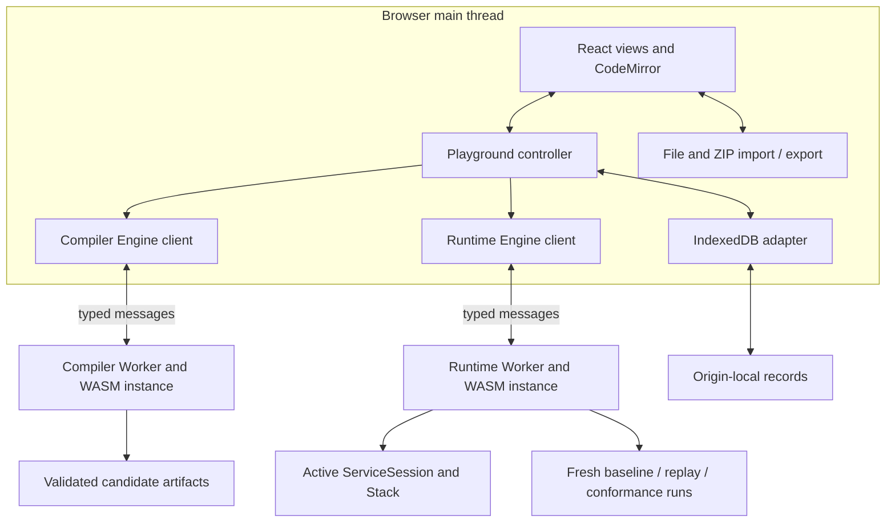
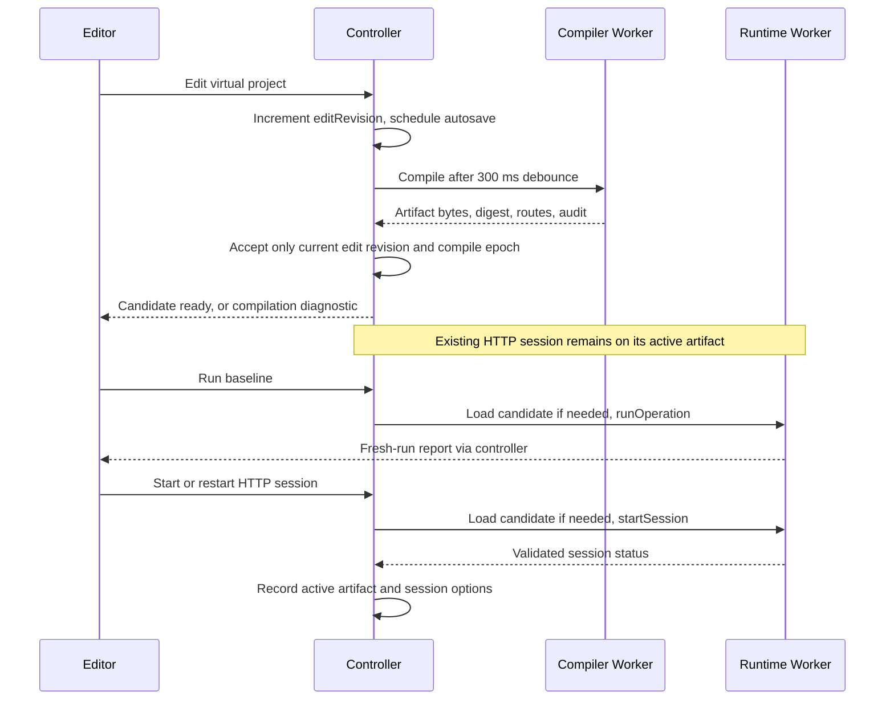
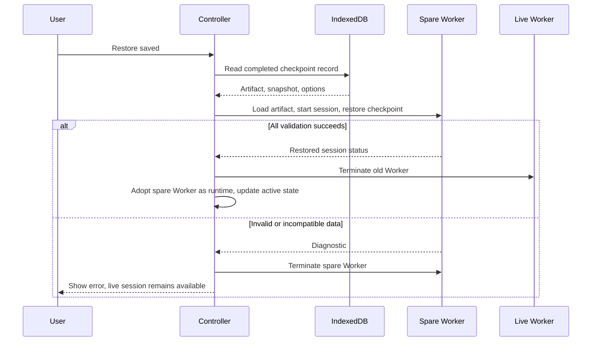
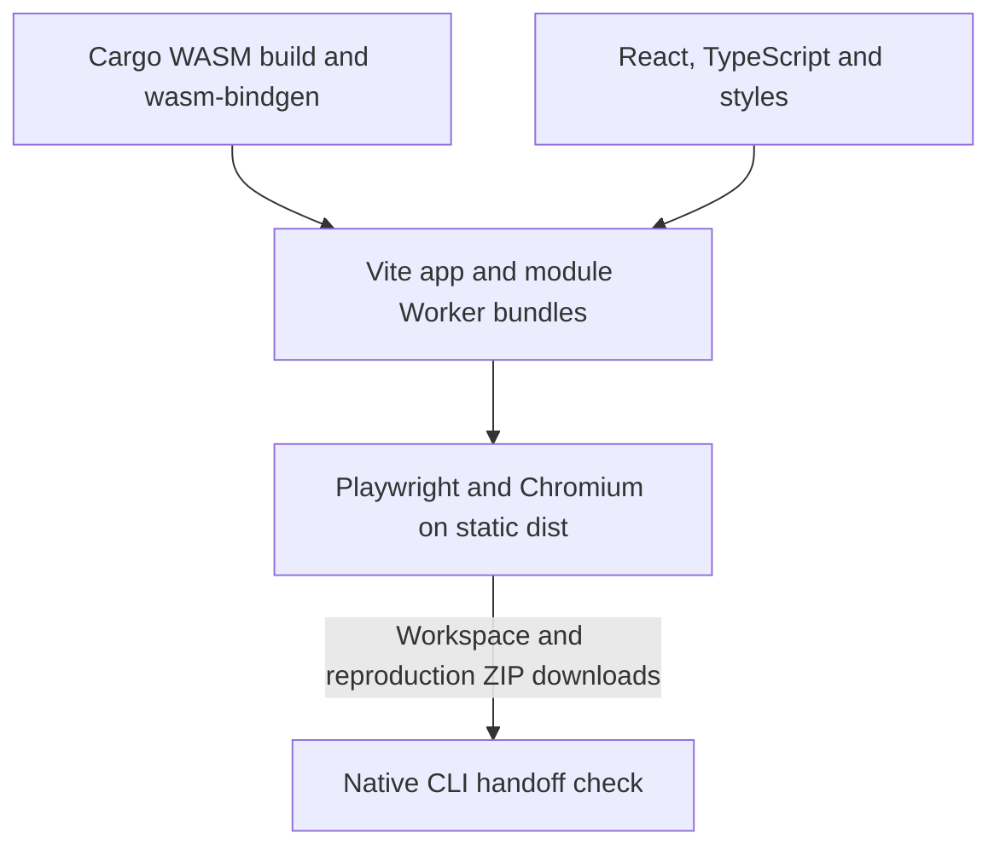

# Playground architecture

The playground is a static browser application for defining a Simile service and
running it on the same screen. React owns presentation, a controller coordinates
work, and two module Workers run the shared Rust/WASM engine. Service compilation
and execution happen locally; HTTP requests in the workbench do not contact a
remote service or open a listener.

See the [README](README.md) for development commands and user workflows, and the
[WASM architecture](../crates/simile-wasm/ARCHITECTURE.md) for the engine's protocol,
value representations, and session guarantees.

## Screen and runtime structure

```text
+------------- New workspace / Import / Export / Guide / Theme --------------+
| Files and      | Definition: files, contract, HCL   | Run / HTTP session   |
| operations     | editor, Format, Compile            | request and response |
|                |                                    | session controls     |
|                +------------------------------------+                      |
|                | Problems / Composition / Describe  |                      |
|                | Audit / Reproduction / Guide       |                      |
+----------------+------------------------------------+----------------------+
```

The definition and execution panes resize horizontally on desktop and stack on
narrow screens. The lower tools panel expands for errors, including a repeated
error with the same message. Execution tabs remain mounted so switching tabs
preserves drafts and results. A new workspace or successful import resets the
baseline form.



Both Workers use the same shared dispatch module and bindings. Their roles are
assigned by the controller, not separate engine implementations. They have
independent memories: artifact bytes must be loaded into the runtime Worker before
it can use a compiler result. Baselines run in the runtime Worker but create fresh
Rust runtimes, so they do not mutate the active HTTP session. Calls within each
Worker are serialized.

| Location | Owns |
| --- | --- |
| [src/App.tsx](src/App.tsx) | Application layout, selected files/operations, pane visibility, and top-level actions. |
| [src/model/controller.ts](src/model/controller.ts) | Observable application state, compilation scheduling, candidate/active revisions, Worker replacement, saves, and checkpoint coordination. React subscribes with `useSyncExternalStore`. |
| [src/worker/client.ts](src/worker/client.ts) | `Engine`: Worker lifecycle, pending calls, fatal errors, and the 60-second watchdog. |
| [src/worker/simile.worker.ts](src/worker/simile.worker.ts) | Imports the shared WASM Worker; does not duplicate dispatch. |
| [src/views/author.tsx](src/views/author.tsx), [runner.tsx](src/views/runner.tsx), [workbench.tsx](src/views/workbench.tsx) | Source authoring, isolated baseline runs, and stateful HTTP/session controls. |
| [src/components/editor.tsx](src/components/editor.tsx), [src/model/format.ts](src/model/format.ts) | CodeMirror lifecycle, themes, undoable edits, and file-type formatting. |
| [src/model/project.ts](src/model/project.ts), [archive.ts](src/model/archive.ts) | Virtual projects, starters, import validation, and native handoff archives. |
| [src/storage/idb.ts](src/storage/idb.ts) | IndexedDB transactions and saved workspace/session record types. |
| [src/views/inspect.tsx](src/views/inspect.tsx), [guide.tsx](src/views/guide.tsx) | Shared artifact inspection and contextual help/documentation links. |

## Edit, compile, then choose what to run

The controller tracks source `editRevision` separately from the artifact's digest.
A successful compilation becomes the **candidate** available to baseline runs.
The **active** artifact belongs to the explicitly started HTTP session. Editing
source or importing an artifact does not replace that session.



Only one compile runs at a time. Edits during compilation coalesce into a later
build; old responses cannot overwrite the current candidate. Compile epochs also
invalidate results after cancellation or a mode change. Cancel terminates and
replaces the compiler Worker, leaving the runtime Worker intact.

Artifact imports decode and validate before changing mode. Artifact mode uses the
embedded contract and behavior, without reconstructing source. Failed imports
leave the current workspace and running session usable. Results retain their
artifact revision so the UI can label a report from an older compilation.

## Request editing and operation authoring

The contract is authoritative. Adding an operation edits OpenAPI or TypeScript,
then compilation supplies the updated route list; HCL only adds behavior.
The runner keeps a draft and fixture association per operation. It synthesizes an
initial request through WASM, and allows compatible workspace request fixtures.
Route metadata includes `acceptsBody`, so a POST fixture cannot silently become a
GET request when switching operations. A pasted body for an operation with no
declared body produces an inline explanation and a removal action.

[request-document.ts](src/model/request-document.ts) uses the JSON syntax tree to
locate the top-level body and edit source ranges. Payload numbers do not pass
through JavaScript `JSON.parse`/`JSON.stringify`. Reports remain Rust-produced
JSON text; files and wire bodies remain bytes. The HTTP form keeps repeated
headers and distinguishes no body from a present JSON `null`. Caller profile
credentials are attached inside Rust only when selected for use.

CodeMirror separates controller-driven updates from user edits to avoid feedback
loops. Formatting is undoable and refuses to overwrite newer edits made while an
async formatter loads. JSON, YAML, TypeScript, and Markdown use lazily loaded
Prettier parsers; HCL/Simfile formatting conservatively reindents while preserving
expressions. Themes use shared color tokens, explicit cursor styling, and syntax
colors verified in both light and dark mode.

## Workspace persistence and runtime persistence

IndexedDB database `simile-playground` has a `records` store. Two independent
records serve different recovery needs:

| Record | Contents | When saved/restored |
| --- | --- | --- |
| `workspace` | Versioned virtual project, notes, mode, last compiled artifact, and named reproduction bundles. | Autosave after a 350 ms debounce; restore on page load and revalidate cached artifact bytes. |
| `checkpoint` | Active artifact bytes, checkpoint bytes, captured session status, and session options. | Explicit Save checkpoint / Restore saved actions. |

Request form drafts are UI state, not saved runtime state. Reload restores source
work but does not automatically resume the HTTP session. A reproduction bundle
captures an execution case for replay/conformance, not an arbitrary live session.
Saved checkpoints can include synthetic profile credentials; they belong to this
browser origin's storage.

Writes resolve on transaction completion, not merely on a successful `put`.
Autosave revision checks prevent a late write from marking newer edits saved.
Checkpoint saves capture a session token (artifact digest, core generation, and
revision); a session epoch distinguishes replacement sessions. A completed save
cannot mark a newer or different live session saved.



Importing checkpoint bytes into the current session instead validates against its
active artifact inside Rust. Both restore paths create a fresh service runtime
with the saved Stack. Replay caches and fault RNG progress restart; old work
handles are invalidated while queue visibility deadlines survive. See the
[WASM session rules](../crates/simile-wasm/ARCHITECTURE.md#sessions-checkpoints-and-deferred-work).

## Failures and recovery

| Failure | Behavior |
| --- | --- |
| Source or operation validation | Show diagnostics in Problems; retain source, candidate, and active session as applicable. |
| Compiler crash, message error, or timeout | `Engine` closes and rejects pending calls. The controller replaces it; the next edit, Compile, or import works with a fresh Worker. The failing request is not retried endlessly. |
| Runtime crash or timeout | Explicit runtime recovery replaces the Worker and loses unsaved runtime state. Source and candidate remain; a saved checkpoint can be restored. |
| IndexedDB open/write failure | Show save failure; keep edits and session usable. Failed connections can be opened again. |
| Invalid saved artifact | Preserve restored source/notes and show the diagnostic; source can be recompiled. |
| Expired work handle | Shared Rust rejects it before side effects. Step work again to obtain a current lease. |

The workbench advances manual time and leases work only on explicit actions.
Webhook preparation displays signed bytes; success/failure controls acknowledge
or retry a simulated recipient. Transport delays and disconnects are displayed as
plans. Neither path performs external network delivery.

## Samples, archives, and native handoff

Starters are virtual projects: Orders (OpenAPI plus HCL), multi-file TypeScript,
blank OpenAPI, and Swagger Petstore. Petstore is a bundled OpenAPI 3.0.3 conversion
of the Swagger 2.0 sample, retaining all 20 operations. Its
[provenance](src/templates/petstore/SOURCE.md), usage notes, and license accompany
the sample; it needs no live fetch or runtime converter.

File/folder/ZIP imports become validated relative paths in the virtual project.
Workspace export includes source, notes, artifact bytes, and `HANDOFF.sh`. Quick
mode first generates and validates a Simfile so native registration compiles the
same configuration. Native profiles are provisioned separately; browser session
credentials are not copied into the CLI registry. Bundle ZIPs use the shared
native reproduction format and can be replayed with the CLI.

## Build and test flow



[build-wasm.mjs](scripts/build-wasm.mjs) pins Rust 1.85.0 and checks the installed
`wasm-bindgen` CLI version before generating `src/wasm/` and the shared harness's
`crates/simile-wasm/pkg/`. [vite.config.ts](vite.config.ts) aliases the shared
Worker's binding import to `src/wasm/`, emits ES module Workers, and uses a relative
asset base. `pnpm build` builds WASM, checks TypeScript, and produces the static app.
Current WASM builds use Cargo's debug profile; release optimization is separate work.

Unit tests cover controller races, Worker recovery, committed persistence,
archives, formatting, and lossless request edits. Playwright runs the production
bundle through full author/compile/run flows, imports, checkpoints, samples,
and light/dark UI checks. [check-handoff.py](scripts/check-handoff.py) consumes the
browser's actual exported files and verifies native registration, setup, an
authenticated HTTP create/read sequence, and bundle replay. The shared crate's
browser harness separately verifies the Worker contract. Commands are in the
[README verification section](README.md#verify).
